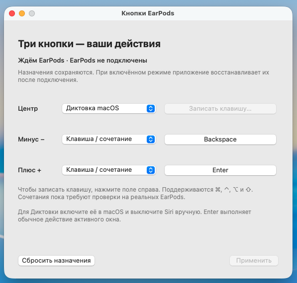

# EarPods AI Keys

**Your EarPods music remote, repurposed for dictation and everyday input on a Mac.**

[Русский](README.ru.md) · [Download for Apple silicon](https://github.com/metalebedenko/earpods-ai-keys/releases/tag/v0.1.0-preview.3) · [MIT](LICENSE)

| Button | Default action |
|---|---|
| Center | Start macOS Dictation; press again to stop in the tested setup |
| − | Backspace — delete a character or selected text |
| + | Enter — the focused app's usual action |

Dictate a prompt, fix a word and press Enter without reaching for the keyboard. It works through system input, so no ChatGPT account, API key or AI service integration is needed. Enter may insert a newline, send a message or execute a terminal command, depending on the focused app.



*The app's real settings window, waiting for EarPods to connect.*

## Install and use

1. Download the **ARM64 DMG** from the [preview release](https://github.com/metalebedenko/earpods-ai-keys/releases/tag/v0.1.0-preview.3), open it and drag **EarPods AI Keys.app** into **Applications**. Eject the image and open the installed copy.
2. In **System Settings → Keyboard → Dictation**, enable Dictation, choose your language and microphone. **Turn Siri off manually:** the tested center-button mapping opens Siri when Siri is enabled. Your existing Dictation keyboard shortcut can stay as it is.
3. Connect **Apple USB-C EarPods**, click the menu-bar icon and choose **«Включить пульт»** (Enable remote). Put the cursor in a text field, then press and release the center button to dictate.

**First launch:** this preview is ad-hoc signed and **not notarized by Apple**. If macOS blocks an unverified-developer build you trust, try opening it once, then go to **System Settings → Privacy & Security → Open Anyway → Open**. macOS normally remembers this exception for that copy on that Mac. A detected-malware or damaged-app alert is a different issue. [Apple's instructions](https://support.apple.com/en-us/102445).

## Make it yours

- **«Настроить кнопки…»** — assign a key, a combination such as ⌘Z, or native Dictation. The current UI is in Russian.
- **«Выключить пульт»** — restore the remote's media controls while keeping your profile.
- **«Запускать при входе»** — optional login startup. The app waits for EarPods and restores its profile when they connect, using device events instead of periodic polling.
- **«Удалить приложение…»** — remove its owned mapping, login registration and settings, then move the app to Trash. Siri and Dictation preferences are left to you.

Custom combinations need macOS Input Monitoring and control permissions. The app preserves foreign mappings and refuses conflicting earlier installations. See the [app guide](docs/app-setup.ru.md) for permissions and migration.

## Compatibility

The downloadable preview is for **Apple silicon** and **Apple USB-C EarPods**. Standard input and reconnection were physically tested on two Macs running **macOS 27.0.1**; the second Mac also passed reboot with EarPods connected and reboot without them followed by connection. ⌘Z and full uninstall/reinstall were tested on the first Mac. Other headsets, Intel binaries and other macOS versions are unverified; the source deployment target is macOS 13+.

The app handles buttons; **macOS handles speech recognition**. It does not guarantee offline Dictation. Normal volume/playback buttons are replaced while remote mode is enabled. See [verification details](docs/verification.md).

## Build from source

Use a Mac with Swift 6 / Command Line Tools. There are no third-party runtime or Swift package dependencies.

```sh
/bin/sh app/build-app.sh release
/bin/sh app/test.sh
python3 -m unittest discover -s tests -v
python3 -m unittest discover -s app/Tests -p 'test_package_dmg.py' -v
```

The build script prints the `.app` path. [Packaging](docs/releasing.md) uses Python 3's standard library and native macOS tools at build time; the installed app needs no Python.

## Project map

- [App guide / permissions / uninstall](docs/app-setup.ru.md) · [How it works](docs/how-it-works.md)
- [Optional legacy shell setup](docs/setup.md) · [Compatibility reports](.github/ISSUE_TEMPLATE/compatibility.md)
- [Release notes](docs/releases/v0.1.0-preview.3.md) · [Project state](PROJECT_SUMMARY.md) · [Decisions](DECISIONS.md)
- [Publication materials](docs/publications/README.md)

Created by **Sergo Lebedovich**. MIT © 2026. Apple, EarPods and macOS are trademarks of Apple Inc.; this is an independent project.
