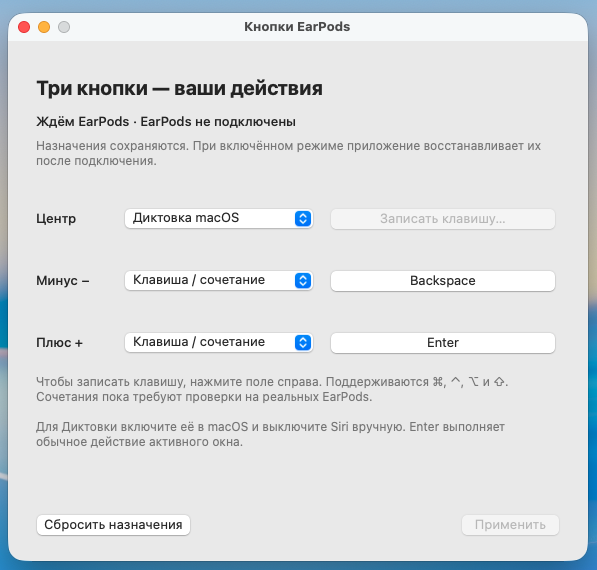

# EarPods AI Keys

**Кнопки проводных USB-C EarPods позволяют включить диктовку на Mac, стереть символ и нажать Enter.**

[English](README.md) · [Скачать для Apple silicon](https://github.com/metalebedenko/earpods-ai-keys/releases/tag/v0.1.0-preview.3) · [MIT](LICENSE)

| Кнопка | Действие по умолчанию |
|---|---|
| Центральная | Диктовка macOS; повторное нажатие останавливает её в проверенной конфигурации |
| − | Backspace — удалить символ или выделенный текст |
| + | Enter — обычное действие в активном приложении |

## Диктовка без клавиатуры

На двух Mac проверили один и тот же сценарий — надиктовать фразу в текстовое поле, стереть лишний символ и нажать Enter с пульта наушников. На втором Mac все три действия работали и после переподключения EarPods, и после перезагрузки компьютера. [Подробнее о проверке на устройстве](docs/verification.md#second-mac-native-app-launch-and-standard-input--physical-report-2026-10-16)

За диктовку отвечает macOS. Для работы с кнопками не нужны аккаунт ChatGPT или API-ключ. Что сделает Enter, зависит от активного приложения. В текстовом поле он может перенести строку или отправить сообщение, а в терминале — выполнить команду.



*Настоящее окно настроек: приложение ждёт подключения EarPods.*

## Установка и работа

1. Скачайте **ARM64 DMG** со [страницы предварительной версии](https://github.com/metalebedenko/earpods-ai-keys/releases/tag/v0.1.0-preview.3), откройте и перетащите **EarPods AI Keys.app** в **«Программы»**. Извлеките образ и запустите установленную копию.
2. В **«Системные настройки → Клавиатура → Диктовка»** включите диктовку, выберите язык и микрофон. **Выключите Siri вручную:** при включённой Siri проверенное назначение центра запускает её. Своё клавиатурное сочетание диктовки можно сохранить.
3. Подключите **Apple USB-C EarPods**, нажмите значок сверху и выберите **«Включить пульт»**. Поставьте курсор в поле ввода, коротко нажмите и отпустите центр, затем диктуйте.

**Первый запуск:** сборка имеет ad-hoc подпись и **не нотарифицирована Apple**. Если macOS блокирует доверенную вам сборку из-за непроверенного разработчика, сначала попробуйте её открыть, затем выберите **«Системные настройки → Конфиденциальность и безопасность → Всё равно открыть → Открыть»**. Обычно разрешение запоминается для этой копии на этом Mac. Сообщение об обнаруженной угрозе или повреждённом приложении — другой случай. [Инструкция Apple](https://support.apple.com/ru-ru/102445).

## Настройка под себя

- **«Настроить кнопки…»** — назначить клавишу, сочетание вроде ⌘Z или диктовку macOS.
- **«Выключить пульт»** — вернуть музыкальные функции, сохранив профиль.
- **«Запускать при входе»** — включить автозапуск. Приложение ждёт наушники и восстанавливает профиль при подключении через события устройства, без периодических опросов.
- **«Удалить приложение…»** — снять своё назначение, убрать автозапуск и свои настройки, затем переместить приложение в Корзину. Настройки Siri и диктовки остаются за вами.

Для сочетаний клавиш нужны разрешения macOS на мониторинг ввода и управление. Чужие назначения приложение сохраняет, а при конфликте со старой установкой отказывается включаться. Разрешения и переход со скриптов описаны в [инструкции приложения](docs/app-setup.ru.md).

## Совместимость

Готовая сборка предназначена для **Apple silicon** и **Apple USB-C EarPods**. Стандартный профиль и переподключение физически проверены на двух Mac с **macOS 27.0.1**; на втором также проверены перезагрузка с наушниками и перезагрузка без них с последующим подключением. ⌘Z и полное удаление с повторной установкой проверены на первом Mac. Другие наушники, готовые Intel-сборки и другие версии macOS пока не проверены; минимальная цель исходников — macOS 13+.

Приложение обрабатывает кнопки, а **речь распознаёт macOS**. Полностью локальная диктовка не гарантируется. Пока пульт включён, обычные функции громкости и воспроизведения заменяются назначениями. [Подробности проверок](docs/verification.md).

## Сборка из исходников

Нужен Mac со Swift 6 / Command Line Tools. Сторонних зависимостей времени выполнения и Swift-пакетов нет.

```sh
/bin/sh app/build-app.sh release
/bin/sh app/test.sh
python3 -m unittest discover -s tests -v
python3 -m unittest discover -s app/Tests -p 'test_package_dmg.py' -v
```

Скрипт напечатает путь к `.app`. Для [упаковки](docs/releasing.md) нужны Python 3 со стандартной библиотекой и инструменты macOS; установленному приложению Python не нужен.

## Карта проекта

- [Приложение, разрешения и удаление](docs/app-setup.ru.md) · [Как это устроено](docs/how-it-works.md)
- [Отдельная прежняя CLI-версия](docs/setup.ru.md) · [Сообщить о совместимости](.github/ISSUE_TEMPLATE/compatibility.md)
- [Примечания к выпуску](docs/releases/v0.1.0-preview.3.md) · [Состояние проекта](PROJECT_SUMMARY.md) · [Решения](DECISIONS.md)
- [Материалы для публикаций](docs/publications/README.md)

Автор — **Sergo Lebedovich**. MIT © 2026. Apple, EarPods и macOS — товарные знаки Apple Inc.; это независимый проект.
