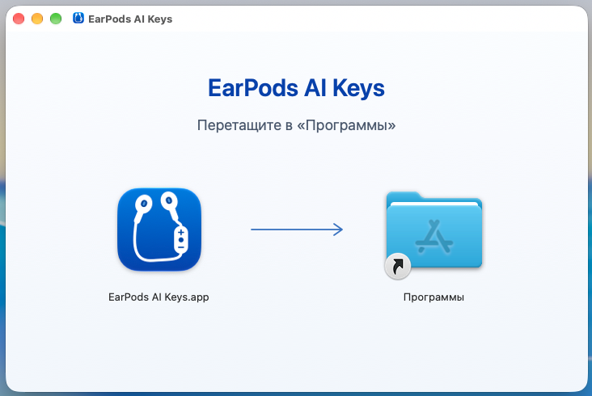

# EarPods AI Keys — установка и настройка приложения

Предварительная версия [v0.1.0-preview.3](https://github.com/metalebedenko/earpods-ai-keys/releases/tag/v0.1.0-preview.3): нативное приложение в строке меню. Переносимая сборка — **ARM64 для Apple silicon, с ad-hoc подписью, без нотарификации Apple**. Это preview, не стабильный выпуск с подтверждением всех конфигураций.

Основной формат доставки — **DMG с перетаскиванием в «Программы»**. Публичная копия основана на проверенной сборке 3: из неё убраны записи отладочных символов с локальными путями, затем обновлена ad-hoc подпись. Все секции исполняемого кода и данных совпадают с проверенной сборкой. Публичная перепакованная копия отдельно на оборудовании не проверялась; её новая подпись может потребовать повторного разрешения для сочетаний. [Метаданные выпуска](../app/validation/public-release.json).

Текущий кандидат — **сборка 3** с иконкой и исправлением первой регистрации запуска при входе. Нативная регистрация подтверждена скриншотом «Объекты входа → Открывать при входе». По отчёту автора от 2026-10-16, после перезагрузки первого Mac без подключённых EarPods значок появился при входе сам, без ручного запуска. После подключения наушников, до открытия меню или «Повторить проверку», сработали центр — старт и остановка диктовки, минус — Backspace, плюс — новая строка. Последующее чтение подтвердило один процесс приложения из Applications, включённый стандартный профиль и точные три пары с соответствующей записью владения. Это результат одной конфигурации без измерения времени готовности. Первоначальные проверки профилей ниже относятся к сборке 1; полный UI-сценарий удаления сборки 3 описан в разделе удаления.

На первом Mac автор физически проверил стандартный профиль приложения: меню показывало «Пульт работает», «−» удалял один символ, «+» вставлял новую строку, центр запускал диктовку и повторным нажатием останавливал её. При включённом режиме «+» и «−» не меняли громкость; после «Выключить пульт» снова управляли громкостью. Штатное действие центральной кнопки после выключения отдельно не проверено.

Переподключение стандартного профиля на первом Mac тоже проверено: после отключения и подключения EarPods диктовка, Enter и Backspace работали до открытия меню или «Повторить проверку». Последующее чтение подтвердило три стандартные пары на новой HID-службе и включённый режим.

На установленной сборке 1 проверен также профиль «−» → ⌘Z: минус отменял текст, после него обычная печать `123` работала; удержанный Command не наблюдался. Центр по-прежнему запускал и останавливал диктовку, плюс вставлял новую строку. Минус не менял громкость — подавление медиадействия в профиле с NoEvent подтверждено физически.

Меню и обнаружение EarPods подтверждены; в живом окне проверены запись ⌘Z и ⌘Enter и сброс к стандартному профилю. В отдельном прежнем тесте реальный helper переместил тестовую копию приложения в Корзину. Чистый первый запуск после повторного копирования и последующие включение пульта, «Запускать при входе» и три действия кнопок подтверждены отчётом автора, как описано в разделе удаления. Переподключение профиля с сочетанием, вход с заранее подключёнными EarPods на первом Mac и поиск через Spotlight ещё требуют проверки. На втором Mac запуск установленного приложения, подключение EarPods, включение пульта, диктовка, Backspace и Enter/newline подтверждены отчётом автора от 2026-10-16. Дополнительный физический отчёт автора подтвердил на втором Mac переподключение, перезагрузку/вход с подключёнными EarPods и перезагрузку/вход без них с последующим подключением. Повторное нажатие центра для остановки, удаление, сочетания и полная очистка на втором Mac пока не сообщены. Точные шаги Gatekeeper и перетаскивания приложения этим отчётом не установлены. Другие сочетания также нуждаются в собственной проверке. Результаты прежнего CLI не доказывают работу этих функций приложения.

## Установить и открыть



*Реальный кадр окна установки: перетащите приложение в папку справа.*

1. Откройте переданный файл **`.dmg`** в Finder.
2. В окне образа перетащите **EarPods AI Keys.app** на папку **«Программы»** справа. Она ведёт в **Applications** на вашем Mac.
3. После завершения копирования извлеките смонтированный образ через Finder.
4. Откройте **Программы / Applications** и запустите установленную **EarPods AI Keys.app**. Используйте эту копию и для настройки запуска при входе.
5. Нажмите значок EarPods AI Keys в строке меню. При первом запуске новый профиль выключен: видны «Режим выключен» и состояние подключения.

Если macOS не позволяет открыть сборку из-за непроверенного разработчика, сначала проверьте её происхождение. Для доверенной сборки используйте штатное **«Открыть всё равно»** в «Системные настройки → Конфиденциальность и безопасность» после первой попытки открытия. Порядок и ограничения описаны в [инструкции Apple](https://support.apple.com/en-us/102445). DMG не отменяет эту проверку macOS.

Если приложение передано в ZIP, распакуйте архив и скопируйте `.app` в Программы; затем запускайте установленную копию тем же способом. Настройка старого CLI остаётся отдельной процедурой миграции, описанной ниже.

Для разработчиков: собрать приложение из исходников на Mac с инструментами Swift:

```sh
/bin/sh ./app/build-app.sh release
```

Скрипт печатает путь к новому `.app` в `app/dist/`. Уже собранное подписанное приложение можно отдельно упаковать в новый DMG:

```sh
python3 app/package-dmg.py '/path/EarPods AI Keys.app' '/path/new-output.dmg'
```

Для упаковки нужны Python 3 со стандартной библиотекой и инструменты macOS Command Line Tools; дополнительных Python-пакетов не требуется. Python нужен только разработчику при упаковке: установленное приложение работает без него. Готовность на Intel и других версиях macOS не подтверждена.

## Перед включением пульта

Подключите USB-C EarPods. Для стандартного профиля включите диктовку в **«Системные настройки → Клавиатура → Диктовка»**, выберите язык и микрофон EarPods. Своё запасное сочетание запуска с клавиатуры можно сохранить.

**Siri нужно выключить вручную.** В прежних физических проверках Consumer VoiceCommand с включённой Siri открывал Siri, а с выключенной — диктовку. Приложение не переключает Siri и не меняет настройки диктовки. Полностью локальное распознавание речи не гарантируется.

Если уже есть скриптовая установка EarPods AI Keys или прежний агент диктовки, приложение откажется включать свои назначения. Оно также сохраняет чужое непустое правило. Для текущих тестовых Mac переход со старой установки выполняем отдельно с агентом: сначала проверяем прежнюю настройку и путь возврата, затем проверяем приложение. Автоматически заменять старую установку кандидат не будет. CLI и его [инструкция](setup.ru.md) сохранены.

После согласованной миграции выберите **«Включить пульт»**. Для первого физического теста поставьте курсор в пустой текстовый документ: центральная кнопка — диктовка, «−» — Backspace, «+» — Enter. Enter выполняет действие активного окна; в терминале он может запустить введённую команду.

## Назначить действия трём кнопкам

Откройте **«Настроить кнопки…»**. В окне «Кнопки EarPods» есть три строки: «Центр», «Минус −», «Плюс +».

- Выберите **«Диктовка macOS»**, чтобы назначить действие диктовки.
- Выберите **«Клавиша / сочетание»**, нажмите поле справа и затем нужную клавишу на клавиатуре. Можно записать сочетание с **⌘ Command, ⌃ Control, ⌥ Option, ⇧ Shift**. Например, для отмены на Mac — ⌘Z.
- Для сочетания **до «Применить»** нажмите **«Разрешения macOS…»** и явно предоставьте разрешения приложению внутри **«Системные настройки → Конфиденциальность и безопасность»**: **«Мониторинг ввода»** и разрешение управления устройством. Дождитесь подтверждения разрешений; так проверка доступа не затронет текущий стандартный профиль до применения нового.
- Проверьте показанное назначение и нажмите **«Применить»**. Закрытие окна без применения не сохраняет новый вариант.

В проверенной русской macOS 27 разрешение управления находится в пункте **«Управление устройством и доступ к данным»** внутри **«Конфиденциальность и безопасность»**. В прежних версиях этот пункт назывался **«Универсальный доступ»**. Найдите в нём **EarPods AI Keys.app**. Отдельный раздел **«Универсальный доступ» в главной боковой панели** относится к специальным возможностям системы; он не является этим списком разрешений приложений.

Запись клавиши работает, когда поле записи находится в фокусе этого окна. Доставка ⌘Z с минуса физически подтверждена на первом Mac; другие сочетания проверяйте отдельно в нужном приложении. Если после предоставления разрешений приложение всё ещё просит доступ, выберите **«Повторить проверку»** в меню.

На первом Mac профиль «−» → ⌘Z удалось применить после перезапуска той же неизменённой сборки. Сохранённый профиль и живое HID-правило подтвердили применение, а последующая физическая проверка — отмену с пульта. Причина первоначального отказа не установлена, поэтому этот результат не гарантирует, что перезапуск устранит любую ошибку разрешений.

Если системные переключатели для приложения включены, но «Применить» всё ещё сообщает об отсутствии разрешений:

1. Выберите в меню **«Выключить и выйти»**.
2. Снова откройте приложение из **Applications / Программы**.
3. Выберите **«Включить пульт»**.
4. Откройте **«Настроить кнопки…»**, заново запишите несохранённый вариант назначения и нажмите **«Применить»**.

Для проверки профиля с «−» → ⌘Z можно использовать TextEdit: напечатать текст, проверить отмену минусом, затем диктовку центральной кнопкой и Enter плюсом. После отпускания минуса обычная печать должна работать без оставшегося нажатым Command. Эти действия кнопок и последующую обычную печать автор подтвердил 2026-10-11 на установленной сборке 1 первого Mac.

## Что означает состояние

| Состояние | Действие |
|---|---|
| «Режим выключен» | Приложение сохраняет профиль, но не включает пульт |
| «Ждём EarPods» | Режим включён, подходящее устройство ещё не найдено |
| «Пульт работает» | Приложение подтвердило свои назначения; проверьте реальные кнопки в нужном поле |
| «Нужно разрешение macOS» | Откройте разрешения, затем повторите проверку |
| Сообщение об ошибке | Прочитайте причину в меню или настройках; при старой установке выполните отдельную миграцию |

Приложение остаётся запущенным в строке меню и обрабатывает события подключения EarPods. Работа стандартного профиля после переподключения физически подтверждена отчётами автора на первом и втором Mac. Переподключение профиля с сочетанием и конфигурации за пределами этих двух Mac ещё не проверены; готовность сразу после входа также не обещается.

## Запускать при входе — по желанию

В меню включите **«Запускать при входе»**. Если появится **«Подтвердить запуск в настройках…»**, откройте этот пункт и подтвердите регистрацию в настройках macOS. Для отключения снимите отметку в меню.

Эта опция предназначена для запуска приложения при входе. Включённый или выключенный режим пульта хранится отдельно. В сборке 1 нажатие «Запускать при входе» завершилось ошибкой; системная запись регистрации приложения не обнаружилась. В сборке 3 исправлена проверка первоначального состояния SMAppService: теперь допускается явная попытка регистрации, после которой всё равно требуется подтверждение системы. Исправление прошло программные тесты и независимое ревью. Автор подтвердил запись EarPods AI Keys.app в системном списке «Открывать при входе», а 2026-10-16 сообщил об автоматическом появлении значка после перезагрузки без наушников и работе всех трёх кнопок после подключения до открытия меню. Отдельный вход с заранее подключёнными EarPods на первом Mac ещё не проверен; время готовности не измерялось.

Инженер Apple DTS поясняет, что состояние `.notFound` может означать отсутствие сведений о ещё не зарегистрированной службе; для основного приложения показан прямой вызов `SMAppService.mainApp.register()`. Это основания исправления, а не доказательство успешного автозапуска нашей сборки. [Разбор начального состояния](https://developer.apple.com/forums/thread/719862), [регистрация основного приложения](https://developer.apple.com/forums/thread/777520).

## Сброс, выключение и удаление

| Действие | Результат по реализации |
|---|---|
| «Сбросить назначения» | Возвращает профиль проекта: диктовка / Backspace / Enter. Режим и опция входа сохраняются |
| «Выключить пульт» | Останавливает управление и снимает только принадлежащее приложению правило. Приложение, профиль и опция входа остаются |
| «Выключить и выйти» | Выключает режим, снимает своё правило и закрывает приложение. Опцию запуска при входе не удаляет |
| «Удалить приложение…» | После подтверждения выключает режим, снимает своё правило, отключает запуск при входе и убирает свои настройки, затем использует механизм перемещения `.app` в Корзину |

Чужие назначения и системные настройки Siri и диктовки сохраняются. Если удаление не завершилось, приложение показывает причину и предлагает «Повторить» или «Позже»; не считайте его завершённым по одному закрывшемуся окну.

2026-10-16 автор выполнил этот пункт на сборке 3 из Applications при включённом пульте, зарегистрированном запуске при входе и подключённых EarPods. Он сообщил, что приложение удалилось, кнопки вернулись к штатным действиям, ошибок не было. Чтение после удаления подтвердило отсутствие приложения и его собственной папки настроек, основного процесса и helper, задач запуска EarPods, а также пустое HID-правило и отключённый активный автозапуск. По коду путь удаления продолжает работу только после строгой проверки системного состояния `.notRegistered`.

Прямой просмотр Корзины был недоступен из-за ограничений macOS, поэтому конечное расположение именно этой удалённой копии в Корзине не подтверждено. Это отдельный результат от прежнего теста helper на временной копии. Отключение активного автозапуска также не означает удаления всех исторических записей macOS.

После проверки удаления сборку 3 скопировали обратно в Applications. Хеши восьми файлов пакета и строгая проверка подписи совпали с проверенным источником. Автор открыл приложение из Программ и подтвердил UI чистого первого запуска: режим выключен, «Запускать при входе» без отметки, назначения — диктовка / Backspace / Enter. Чтение подтвердило работающий процесс и пустое HID-правило. Файл `settings.json` тогда ещё отсутствовал: настройки записываются при первом сохранении. Поэтому выключенный режим и стандартные назначения именно первого запуска подтверждены интерфейсом, а не сохранённым JSON.

Затем автор выполнил «Включить пульт», «Запускать при входе» и проверил центр, Backspace и Enter, сообщив, что всё сработало. Свежее чтение подтвердило включённый стандартный профиль и точные три пары, соответствующие записи владения. Повторное включение и регистрация после переустановки подтверждены отчётом автора; это не новая проверка запуска после перезагрузки.

## Что уже проверено

Прошли **40 Swift Testing тестов**: 17 для ядра, 16 для управления приложением и 7 для ограниченного выполнения системных команд. Исправление первой регистрации прошло независимое статическое ревью без неустранённых блокирующих замечаний. Проверены сборка и подпись кандидата; нативная регистрация сборки 3 подтверждена системным UI, автоматический запуск после входа без наушников и кнопки после подключения — отчётом автора от 2026-10-16. Полный UI-сценарий удаления сборки 3 подтверждён отчётом автора и ограниченными проверками отсутствия установки, правила и активного автозапуска, описанными выше. Первоначальные физические проверки профилей на первом Mac относятся к сборке 1.

Физические проверки стандартного профиля, возврата громкости после выключения, работы после переподключения и совместной работы ⌘Z с диктовкой и Enter описаны выше. При проверке выключения подтверждены стандартный сохранённый профиль и пустое HID-правило; при последующем переподключении — включённый стандартный профиль и точные три пары. Перед заменой сборки 1 на сборку 3 автор сбросил назначения, выключил пульт и вышел; подтверждены выключенный стандартный профиль, пустое HID-правило и отсутствие процесса. После сценария перезагрузки без EarPods на сборке 3 чтение подтвердило один процесс приложения, включённый стандартный профиль и точное принадлежащее ему правило; после дальнейшего UI-удаления — отсутствие установки и собственного правила. Пакет затем проверенно скопирован обратно; чистый первый запуск со стандартными назначениями и выключенными режимом и автозапуском подтверждён UI-отчётом автора. Последующие включение, «Запускать при входе» и три действия кнопок также подтверждены автором, а включённый профиль и пары — чтением. По отчёту автора от 2026-10-16, на втором Mac также сработали запуск установленного приложения, подключение и включение пульта, диктовка, Backspace и Enter/newline. Переподключение профиля с сочетанием, другие сочетания, вход с заранее подключёнными EarPods на первом Mac и поиск через Spotlight остаются отдельными проверками. Последующим физическим отчётом автор подтвердил на втором Mac переподключение, перезагрузку/вход с EarPods и перезагрузку/вход без EarPods с последующим подключением. На втором Mac ещё не сообщены повторная остановка диктовки центральной кнопкой, удаление, сочетания и полная очистка; точные шаги Gatekeeper и drag-to-Applications также не подтверждены. Общее состояние проекта и подробные границы результатов ведутся в [PROJECT_SUMMARY](../PROJECT_SUMMARY.md) и [verification](verification.md).
