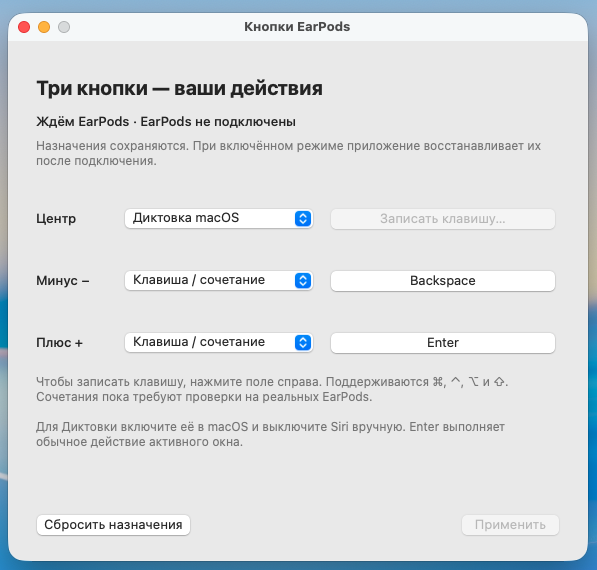
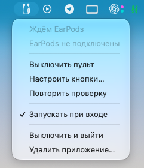

# Хабр — технический редакционный материал

**NOT FOR DIRECT POST. Не готовый текст для прямой публикации.**

Будущий автор: **Sergo Lebedovich**. Рабочая версия: 2026-10-16. Публикация не отправлялась.

Правила Хабра ограничивают тексты, сгенерированные, написанные или отредактированные с помощью нейросетей; исключение для небольшого дополнения к большому авторскому техническому материалу не делает этот цельный черновик допустимой статьёй. Автору необходимо самостоятельно написать собственную статью на основе кода, результатов и своего опыта. Стилизация или «очеловечивание» этой заготовки не подтверждает соответствие правилам. [Официальные правила, пункт 4](https://habr.com/ru/docs/help/rules/).

Ниже — фактическая и композиционная опора от первого лица. Перед использованием проверить доступность репозитория, тега `v0.1.0-preview.3` и двух реальных скриншотов. Самопиар не должен подменять технический материал; правила допускают полезные тематические ссылки. Это не обещание одобрения модерацией.

<!-- ARTICLE -->

# Как я превратил музыкальный пульт EarPods в диктовку, Backspace и Enter на Mac

Купил проводные USB-C EarPods и захотел запускать диктовку центральной кнопкой. Потом посмотрел на две соседние: почему бы минусом не исправлять текст, а плюсом не нажимать Enter? Получился небольшой пульт ввода: говорю промпт, удаляю лишний символ и продолжаю. Сейчас это нативное приложение для строки меню macOS — EarPods AI Keys.

Мой основной сценарий — работа с ИИ в приложении и терминале. Но действие идёт в активное поле ввода, поэтому подходит и для обычного текста. Специальной интеграции с ChatGPT или другим сервисом в приложении нет. Enter остаётся Enter: в чате он может отправить сообщение, в редакторе вставить строку, в терминале выполнить команду.

## Три кнопки и несколько лишних идей

Сначала хватало скрипта со штатной утилитой macOS. Затем я попробовал диктовку конкретного приложения и отмену последней вставки. В моих проверках это работало непоследовательно: одно окно понимало отмену, другое — нет. Я остановил усложнение и выбрал Backspace. Удалить символ перед курсором проще проверить, чем договориться со всеми приложениями об истории правок.

Ещё мне не нравилась идея проверять правило каждые 15 секунд. Скриптовый вариант стал применять его один раз при входе. Однако после переподключения наушников приходилось восстанавливать настройку вручную. Поэтому появился следующий запрос: небольшой интерфейс включения, назначения трёх кнопок и восстановление при подключении.

Приложение разрабатывал с помощью ИИ и проверял на реальных Mac и наушниках. Критерием для меня были нажатия в обычном поле ввода: начинается ли диктовка, удаляется ли текст и возвращается ли громкость после выключения режима.

## Где заканчивается hidutil

У пульта есть отдельная Consumer Control HID-служба. Приложение ищет конкретные USB-C EarPods: Vendor ID 1452, Product ID 4363, Usage Page 12, Usage 1. Переназначение применяется к этому устройству; основная клавиатура сохраняет свои назначения.

Для стандартного профиля достаточно трёх пар:

| Кнопка | Исходное событие | Назначение |
|---|---|---|
| Центр | Play/Pause | Consumer VoiceCommand, 0xCF |
| Минус | Volume Decrement | Keyboard Backspace |
| Плюс | Volume Increment | Keyboard Return/Enter |

`hidutil` задаёт `UserKeyMapping`: соответствие исходного и целевого HID-события. Механизм описан в [Apple TN2450](https://developer.apple.com/library/archive/technotes/tn2450/_index.html). Само приложение речь не распознаёт: это делает встроенная диктовка macOS.

Одно целевое событие удобно для Backspace, Enter или функциональной клавиши. А вот ⌘Z содержит модификатор и клавишу. Записать такую последовательность одной парой `UserKeyMapping` не получается, поэтому для сочетаний понадобился другой путь.

## Как устроены сочетания

В настройках можно выбрать «Клавиша / сочетание» и записать на клавиатуре нужное действие с Command, Control, Option или Shift. Для соответствующей кнопки приложение получает исходные события EarPods через IOKit и отправляет полную пару нажатие/отпускание через CoreGraphics.

Открытие устройства неэксклюзивное. Исходная медиакнопка, назначенная на сочетание, перенаправляется в Keyboard NoEvent. Иначе нажатие минуса могло бы одновременно вызвать отмену и изменить громкость. Обычные одиночные клавиши и диктовка продолжают идти через HID-переназначение.

Этот режим требует системных разрешений на мониторинг ввода и управление. На первом Mac переключатели уже были включены, но применение профиля всё ещё завершалось ошибкой. После перезапуска той же сборки профиль применился. Причину первого отказа я не установил; универсального рецепта из одного такого случая не делаю.

Затем проверил минус → ⌘Z: текст отменялся, после этого нормально печаталось `123`, центр запускал и останавливал диктовку, плюс вставлял строку. Минус при этом не менял громкость; оставшийся нажатым Command не наблюдался.

## Подключение, вход и собственные настройки

Приложение остаётся одним процессом в строке меню и наблюдает события подключения устройства через IOKit. При появлении EarPods оно сверяет и применяет профиль. Есть ограниченные повторные попытки после события, когда служба ещё не готова, но постоянного опроса по таймеру нет.

Запуск при входе включается отдельно через SMAppService. Неподключённые наушники означают состояние ожидания. На первом Mac я проверил перезагрузку без EarPods: приложение появилось само, после подключения работали все три действия до открытия меню и повторной проверки. На втором подтвердил переподключение и оба варианта перезагрузки — с наушниками и без них с последующим подключением. Точное время готовности не измерял.

Переназначение временное, поэтому восстановление действительно нужно. Apple указывает потерю правил при перезапуске системы или удалении HID-службы. Приложение сохраняет сведения о собственном правиле и отказывается затирать чужое непустое или непонятное соответствие. При выключении и удалении оно снимает только своё правило.

## Неожиданная роль Siri

При переносе на второй Mac центральная кнопка открывала Siri. На первом Siri была выключена, на втором — включена. После ручного выключения Siri диктовка заработала без смены правила. Поэтому для текущего проверенного профиля выключенная Siri — условие настройки.

VoiceCommand здесь нельзя безоговорочно называть копией клавиши микрофона Apple: наблюдаемая реакция зависит от системных предпочтений. Приложение само Siri не отключает. Запасной клавиатурный запуск диктовки можно оставить привычным: у меня использовались Fn дважды и Control дважды.

## Как попробовать и что проверено

Текущий кандидат — ARM64-сборка для Apple silicon, упакованная в DMG. Открываю образ, перетаскиваю приложение в Программы, извлекаю образ и запускаю установленную копию. Включаю диктовку в настройках macOS, выбираю язык и микрофон EarPods, затем включаю пульт в его меню.

Сборка имеет ad-hoc подпись и не нотарифицирована Apple. При предупреждении о непроверенном разработчике штатный путь — «Конфиденциальность и безопасность → Открыть всё равно» для доверенной копии. Он описан в README и [инструкции Apple](https://support.apple.com/ru-ru/102445). Упаковка в DMG эту проверку не отменяет.

Для нативного приложения прошли 40 изолированных Swift Testing тестов. На первом Mac дополнительно проверены выключение с возвратом громкости, сочетание ⌘Z, удаление через меню с возвратом штатных кнопок и чистая переустановка. На втором подтверждены стандартный ввод, переподключение и два сценария перезагрузки. Удаление и сочетания на втором отдельно не проверялись.

В проекте задан минимум macOS 13 по используемым API, но физические проверки выполнены на macOS 27.0.1. Другие версии и несколько одинаковых подключённых EarPods требуют отдельных проверок; для Intel понадобится отдельная сборка и проверка. Распознавание обеспечивает macOS; полностью офлайн-обработку проект не гарантирует. Режим обработки Apple предлагает смотреть в [настройках диктовки](https://support.apple.com/en-gb/guide/mac-help/mh40584/mac).

Исходники — [EarPods AI Keys](https://github.com/metalebedenko/earpods-ai-keys), кандидат — [v0.1.0-preview.3](https://github.com/metalebedenko/earpods-ai-keys/releases/tag/v0.1.0-preview.3). Мне хотелось сделать повторяемую настройку с понятным выключением и удалением. Получился способ дать обычному пульту на проводе ещё одну работу.
