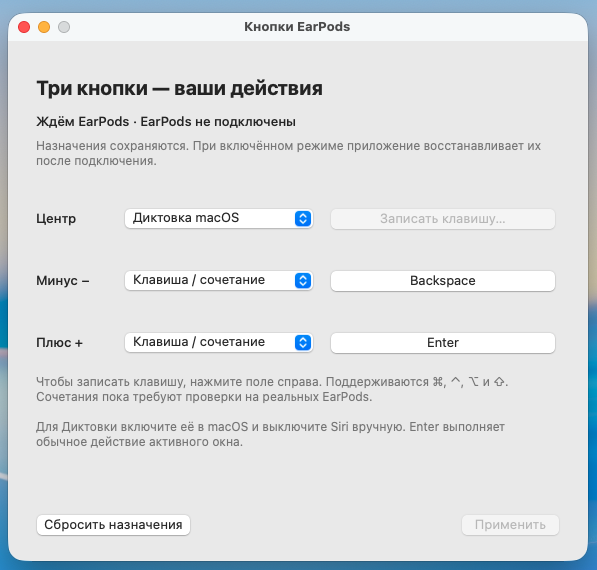

# Пикабу — черновик личного поста

Статус: 2026-10-16, не опубликовано. Автор будущего поста: **Sergo Lebedovich**. Перед публикацией автор проверяет формулировки, ссылки на репозиторий/превью и реальный скриншот.

Редакционная пометка: текст подготовлен с помощью ИИ. Официальные правила Пикабу предусматривают тег **«Контент нейросетей»** для постов из сгенерированного контента. Если использовать этот текст, маркировку нужно учитывать; тег «Моё» автоматически вместо неё не предлагается. Пост должен оставаться самостоятельным материалом, а не ссылкой на продолжение. Правила о рекламе также применяются; обещания одобрения модерацией нет. [Кодекс Пикабу, пункты 1.3, 1.4 и 8](https://pikabu.ru/information/rules).

<!-- ARTICLE -->

# Купил проводные EarPods и превратил пульт для музыки в пульт ввода на Mac

Оказалось, у проводных наушников есть довольно удобное второе применение. Я работаю с ИИ на Mac и часто хочу просто произнести промпт. Но после диктовки всё равно нужно поправить ошибку и нажать Enter. А на проводе под рукой уже три кнопки.

Сейчас у меня такая схема:

- Центральная кнопка запускает диктовку macOS.
- «−» работает как Backspace: удаляет символ перед курсором или выделенный текст.
- «+» нажимает Enter в активном окне.

То есть говорю, вижу лишний символ, удаляю его минусом и продолжаю. Когда текст готов, нажимаю плюс. Мне это нужно для промптов в приложении и терминале. Но тут важная деталь: плюс не умеет угадывать намерение. Где Enter отправляет сообщение — отправит; где переносит строку — перенесёт; в командной строке может выполнить команду.

Сначала я хотел назначить на минус отмену всей последней диктовки. Начались нюансы: в одном приложении отмена срабатывала, в другом вела себя иначе. В какой-то момент решил, что уже слишком глубоко полез ради кнопки. Обычный Backspace оказался для меня удобнее.

Теперь это маленькое приложение EarPods AI Keys, которое живёт в строке меню. У него есть включение и выключение пульта, настройки трёх кнопок и необязательный запуск при входе. При выключенном режиме громкость снова регулируется обычным образом.

Назначения можно менять: например, поставить на минус ⌘Z. Такой вариант я тоже проверил — отмена работала, после неё нормально печатался обычный текст, диктовка на центре и Enter на плюсе продолжали работать. Для сочетаний macOS запрашивает дополнительные разрешения.

Приложение разрабатывал с помощью ИИ и проверял на реальных Mac и наушниках. Проверки, кстати, оказались важнее красивой идеи. На втором компьютере центральная кнопка сначала вызывала Siri. Выяснилось, что там Siri была включена. Выключил её вручную — диктовка заработала. Для нынешнего варианта настройки Siri нужно оставить выключенной; само приложение за пользователя этого не делает.

Ещё проверили сценарий, который в ранней настройке раздражал: отключил наушники, потом подключил обратно. Теперь приложение замечает подключение и восстанавливает профиль без ручной команды. На втором Mac я также проверил перезагрузку с подключёнными EarPods и перезагрузку без них с последующим подключением. Пульт работал в обоих случаях. Постоянной проверки каждые несколько секунд здесь нет, но само приложение остаётся запущенным в строке меню.

Для установки открываю DMG, перетаскиваю приложение в Программы, извлекаю образ и запускаю установленную копию. Затем включаю системную диктовку, выбираю микрофон EarPods и включаю пульт. На первом Mac отдельно проверил удаление через меню: приложение убралось, штатные кнопки вернулись. После повторной установки настройки начались с выключенного режима.

Пока это превью для Mac на Apple silicon. Проверено на двух моих Mac с macOS 27.0.1; это не обещание работы на любом компьютере и любой системе. Сборка не нотарифицирована Apple, поэтому при первом запуске может понадобиться штатное «Открыть всё равно» из настроек конфиденциальности и безопасности. Инструкция есть в README.

И полностью офлайн-диктовку я здесь не обещаю: распознаёт речь сама macOS, а способ обработки зависит от её возможностей и настроек. [Что об этом пишет Apple](https://support.apple.com/en-gb/guide/mac-help/mh40584/mac).

[Исходники и описание EarPods AI Keys на GitHub](https://github.com/metalebedenko/earpods-ai-keys), версия для пробы — `v0.1.0-preview.3`. Если у вас уже есть такие наушники и Mac, возможно, эта дополнительная работа для трёх кнопок тоже окажется удобной.
